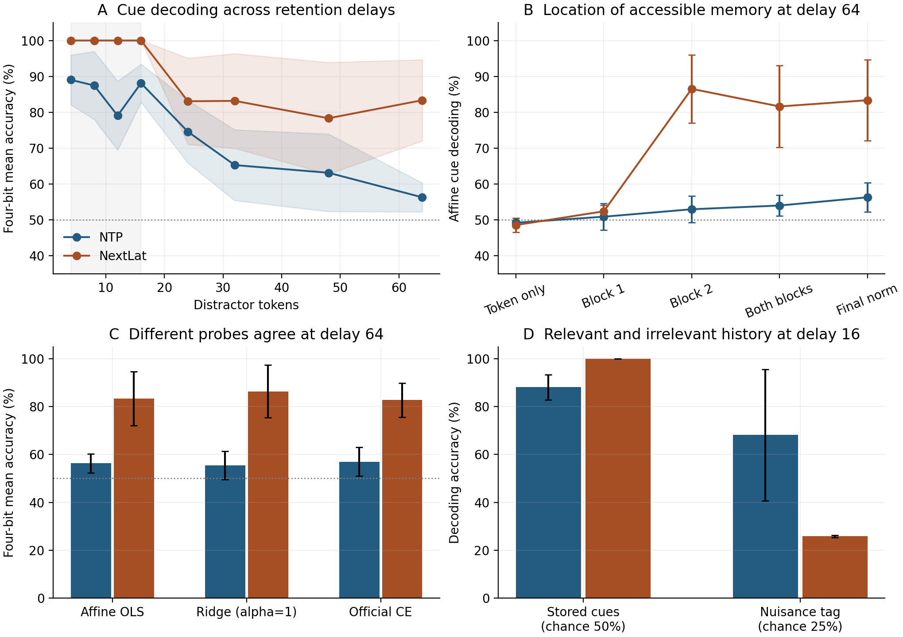

# When Does Compression Forget Too Much?

**Belief-state capacity, state aliasing, and generalization in NextLat**

**Aditi & Sushanth** · CSCI-GA.3033 The Science of Deep Learning · Fall 2026

We first validate the released NextLat implementation on the published Path-Star
benchmark, then study whether it preserves task-relevant historical information
in a controlled four-cue memory task. Standard next-token prediction (NTP) and
NTP + NextLat use the same Transformer architecture and matched training streams.

The current evidence supports **memory preservation in a specific setting**.
It does not establish harmful compression or a universal NextLat advantage.

## Results available now

### Published benchmark validation

Path-Star **G(5,5)**, one matched seed (1234), 200,000 fixed training examples,
20,000 updates, and 20,000 held-out test examples:

| Model | Sampled full-path accuracy | Greedy full-path accuracy |
|---|---:|---:|
| NTP | 18.625% | 18.965% |
| NextLat | 98.630% | 99.500% |

These are our measurements using the authors' model, generator and sampled-path
evaluator. They qualitatively reproduce the reported separation; they are not
the paper's full multi-seed, multi-topology replication.

### Our four-cue memory experiment

A sequence presents four binary cues, an irrelevant four-way tag, distractors,
and a later query asking for one cue. The query index is unknown before it arrives,
so any of the four cues can matter. Sequences are synthetic and generated on the
fly; evaluation families are separate from training and probe-fitting families.

We trained 24 models: **2 objectives × 2 delay schedules × 2 supervision scopes ×
3 seeds**. Each model has two layers, width 128 and four attention heads. The final
budget is 6,000 updates × batch size 32 = **192,000 sequence presentations per model**;
this is not a guarantee of 192,000 distinct sequences. NextLat uses auxiliary
weights 1, horizon 3 and predictor hidden width 128.

Below: training on every integer delay 4–16, response supervision, and evaluation
at **delay 64**. Probes read one final-normalized state **before the query index
arrives**, decoding all four stored bits independently.

| Metric | NTP | NextLat |
|---|---:|---:|
| Shai-style affine cue probe | 56.3% ± 4.0% | 83.4% ± 11.3% |
| Ridge cue probe (alpha = 1) | 55.5% ± 6.0% | 86.4% ± 11.0% |
| Official linear CE heads, adapted cue targets | 57.0% ± 6.0% | 82.7% ± 7.1% |
| Native unrestricted answer recall | 60.3% ± 12.8% | 79.9% ± 4.5% |

Values are **mean ± sample SD across three training seeds** (1237–1239), not
confidence intervals. Binary cue chance is 50%. Shuffled-training-label affine
controls average 50.3% for NTP and 50.8% for NextLat.



NTP has better native recall at delays 24, 32 and 48 in this condition. Probe
accuracy and native generation measure different behaviors; neither a failed
linear probe nor a wrong output token proves that information was erased.

## Start here

- [Midterm check-in PDF](docs/Midterm_Checkin.pdf)
- [Detailed findings and all-condition table](docs/MIDTERM_RESULTS.md)
- [Methods and reproduction guide](docs/REPRODUCING.md)
- [Result file guide](results/README.md)
- [Third-party source attribution](THIRD_PARTY_NOTICES.md)

## Setup

Python **3.12** was used for the recorded CPU experiments.

```sh
git clone --recurse-submodules https://github.com/sushxxnth/nextlat-memory-study.git
cd nextlat-memory-study
python3 -m venv .venv
source .venv/bin/activate
python -m pip install -r requirements.txt
```

For a clone without submodules, run `git submodule update --init`. On a CUDA
machine install the appropriate PyTorch build for that machine. The official
upstream checkout is pinned to commit
`3770be6009cea2b3c455a9ce7f2ca88b504bb955`, and every training run checks that it
is at that commit with no tracked modifications.

## Check the code and recorded metrics

Run from the repository root, with the environment activated:

```sh
export OPENBLAS_NUM_THREADS=2
export MPLCONFIGDIR="$PWD/.matplotlib"
python -m unittest test_validation memory.test_memory memory.test_controls memory.test_published_probes -v
python scripts/verify_recorded_results.py
```

The unit checks cover causal masking, prompt-loss boundaries, zero-auxiliary
loss/gradient equivalence, matched data, exact continuation, and probe controls.
The offline verification checks archived evidence hashes and recomputes the
headline aggregate probe metrics. It does not rerun inference from saved models.

A short four-cue smoke run is also available:

```sh
python -m memory.experiment --config configs/memory_four_cue_smoke.json --out runs/four_cue_smoke
```

This is a pipeline check, not the experiment underlying the results table.

## Reproduce the final control study

```sh
python -m memory.controls --out reproduction/controls_2000 --workers 2
python -m memory.extend_controls --source reproduction/controls_2000 --out reproduction/controls_6000 --steps 6000 --workers 2
python -m memory.published_probes --run reproduction/controls_6000 --out reproduction/probes
python -m memory.probe_report --out reproduction/probes
python -m memory.probe_causality_audit --run reproduction/controls_6000 --out reproduction/probes
```

Use fresh output directories. This trains all 24 models; the commands above
reproduce the two-budget procedure. New runs have newly recorded paths and hashes.

## Important limits

- Three training seeds and a small synthetic task; the probe analysis reuses
  previously examined test families, so these are exploratory findings.
- Every model was uniformly continued from 2,000 to 6,000 updates after validation
  learning failures, with initial test results already visible. Both budgets are
  preserved; no best-test checkpoint was selected.
- Several dense/full-supervision models fail the learning gate. Matched NTP and
  NextLat pairs pass together in only one of three seeds in that condition.
- Response supervision masks NTP/KL to ANSWER/EOS while retaining context latent
  Smooth L1. It changes loss normalization and representation training, not only
  output-head behavior. Normal inference still uses full causal attention.
- Predictor-MLP width is not a hard bottleneck on the Transformer hidden state.
- The affine and CE readouts are adaptations of published methods. Some CE fits
  reach their fixed optimizer iteration cap; OLS and ridge independently support
  the observed pattern.

Large model checkpoints, generated datasets, feature arrays, fitted probe objects,
local virtual environments, credentials and course cluster access configuration
are excluded from Git. Recorded metrics, raw training histories, plans, audit
files and historical source snapshots are included. Their original paths in audit
metadata are provenance, not portable runtime configuration.

## Next experiments

Fresh held-out evaluation, additional seeds, auxiliary-weight and retention-delay
sweeps, fixed-length/fixed-vocabulary cue-capacity tests, nonlinear probes and
causal interventions on the early cues.

## References

- Teoh et al., [Next-Latent Prediction Transformers Learn Compact World Models](https://arxiv.org/abs/2511.05963v4).
- Shai et al., [Transformers Represent Belief State Geometry in their Residual Stream](https://arxiv.org/abs/2405.15943).
- [Official NextLat source](https://github.com/JaydenTeoh/NextLat), pinned as `upstream/`.

The upstream code is MIT licensed; its original license is retained in the
submodule. No additional license is assigned to our original course-project code
by this repository setup.
