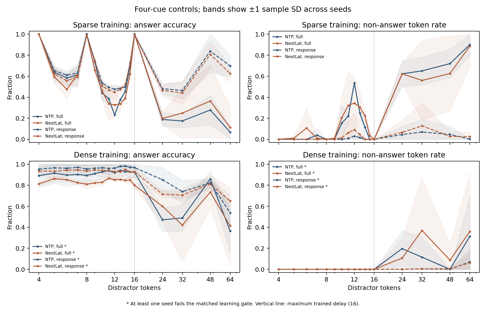

# Four-cue supervision and delay-coverage controls

**Aditi & Sushanth — Science of Deep Learning**

Completed 24/24 runs; fresh seeds [1237, 1238, 1239]; 2000 steps per run. Mean ± sample SD across training seeds; not confidence intervals.

All cells use a four-cue task, 2-layer/128-wide/4-head transformer, batch 32, AdamW learning rate 0.0005, weight decay 0.1 and gradient clip 1. Runs execute on CPU in float32. These are small-model controls, not paper-scale replications.

Sparse training uses delays 4,8,16. Dense training samples every integer 4–16 uniformly. Response-only supervision uses the authors' prompt mask on NTP and KL: only ANSWER/EOS targets are supervised. Context Smooth L1 remains active. Full-sequence supervision matches the previous experiment. NextLat has weight 1, horizon 3 and predictor width 128 throughout. Primary recall is always unrestricted full-vocabulary generation; response masking changes training only. Two-answer recall is a separately labeled diagnostic.

| Condition | Min common-delay recall | Min all-trained-delay recall | Delay 12 recall | Delay 32 recall | Delay 64 recall | Two-answer recall 64 | Non-answer rate 64 | Full learning gate |
|---|---:|---:|---:|---:|---:|---:|---:|---:|
| sparse_full_gpt | 100.0% ± 0.0% | 100.0% ± 0.0% | 23.2% ± 0.8% | 17.4% ± 6.6% | 6.8% ± 6.3% | 57.9% ± 4.2% | 90.0% ± 10.3% | 3/3 |
| sparse_full_nextlat | 100.0% ± 0.0% | 100.0% ± 0.0% | 32.7% ± 11.5% | 25.0% ± 24.0% | 11.3% ± 19.5% | 69.2% ± 12.8% | 88.7% ± 19.5% | 3/3 |
| sparse_response_gpt | 100.0% ± 0.0% | 100.0% ± 0.0% | 47.6% ± 3.2% | 46.4% ± 7.6% | 69.9% ± 10.1% | 69.9% ± 10.1% | 0.1% ± 0.2% | 3/3 |
| sparse_response_nextlat | 98.9% ± 2.0% | 98.9% ± 2.0% | 44.7% ± 7.2% | 44.2% ± 11.3% | 62.6% ± 7.6% | 63.9% ± 5.9% | 2.5% ± 4.3% | 3/3 |
| dense_full_gpt | 87.6% ± 9.8% | 87.6% ± 9.8% | 91.9% ± 7.0% | 48.9% ± 12.8% | 36.5% ± 20.9% | 54.1% ± 2.9% | 31.4% ± 38.4% | 1/3 |
| dense_full_nextlat | 78.7% ± 1.4% | 78.4% ± 1.2% | 85.2% ± 1.4% | 42.0% ± 34.5% | 41.2% ± 36.6% | 63.4% ± 5.6% | 36.1% ± 55.5% | 0/3 |
| dense_response_gpt | 95.1% ± 6.9% | 95.0% ± 6.9% | 96.3% ± 4.8% | 73.9% ± 10.7% | 53.7% ± 11.2% | 57.6% ± 7.0% | 7.0% ± 12.2% | 2/3 |
| dense_response_nextlat | 91.5% ± 5.2% | 90.4% ± 6.9% | 92.8% ± 8.9% | 70.6% ± 3.6% | 65.0% ± 5.6% | 67.0% ± 3.0% | 6.2% ± 8.9% | 1/3 |

## Paired effects at delay 64

Effects below are paired within seed; positive recall is an increase, while negative non-answer rate is a reduction in wrong token types. All seeds are retained even if a learning gate fails. Such cases remain confounded by training performance.

| Contrast | Recall difference (percentage points) | Non-answer rate difference (percentage points) |
|---|---:|---:|
| response_minus_full/sparse/gpt | +63.1 ± 15.4 | -89.9 ± 10.3 |
| response_minus_full/dense/gpt | +17.3 ± 31.9 | -24.3 ± 47.8 |
| dense_minus_sparse/full/gpt | +29.7 ± 20.0 | -58.7 ± 35.4 |
| dense_minus_sparse/response/gpt | -16.1 ± 16.6 | +6.9 ± 12.3 |
| mask_by_distribution_interaction/gpt | -45.8 ± 36.6 | +65.6 ± 43.0 |
| response_minus_full/sparse/nextlat | +51.4 ± 13.4 | -86.3 ± 17.8 |
| response_minus_full/dense/nextlat | +23.8 ± 31.2 | -29.8 ± 46.7 |
| dense_minus_sparse/full/nextlat | +30.0 ± 35.9 | -52.7 ± 50.2 |
| dense_minus_sparse/response/nextlat | +2.4 ± 3.7 | +3.8 ± 4.7 |
| mask_by_distribution_interaction/nextlat | -27.6 ± 34.3 | +56.4 ± 45.6 |
| nextlat_minus_ntp/sparse/full | +4.5 ± 20.9 | -1.3 ± 23.5 |
| nextlat_minus_ntp/sparse/response | -7.2 ± 17.3 | +2.3 ± 4.4 |
| nextlat_minus_ntp/dense/full | +4.8 ± 43.7 | +4.7 ± 73.2 |
| nextlat_minus_ntp/dense/response | +11.3 ± 11.6 | -0.8 ± 18.9 |

## Verification and interpretation limits

The source snapshot and plan hashes match. All training histories are finite and sequential. Models/masks share exact training streams within each schedule; all four cells share the same evaluation and probe-training families per seed. Probe training uses delays 4,8,16 in every cell, avoiding unequal decoder-training budgets. Probe/test families are disjoint. The response/EOS never enters an evaluation forward pass.

The full gate requires both matched models to reach at least 95% recall at every delay trained in that cell. The common gate uses only 4,8,16. Delay 12 is trained in the dense cells and unseen in the sparse cells; 24,32,48,64 are unseen for every cell. Better performance at 12 in dense training is not OOD extrapolation.

All cells have equal optimization steps and examples, but sparse/dense schedules have slightly different expected token counts. Response masking changes both NTP and KL target normalization and their balance against context Smooth L1. It is a token-supervision intervention, not a head-only intervention. Frozen-probe failures do not prove erasure, and long rollouts can accumulate transition error. These controls do not resolve all positional or memory-capacity confounds.

