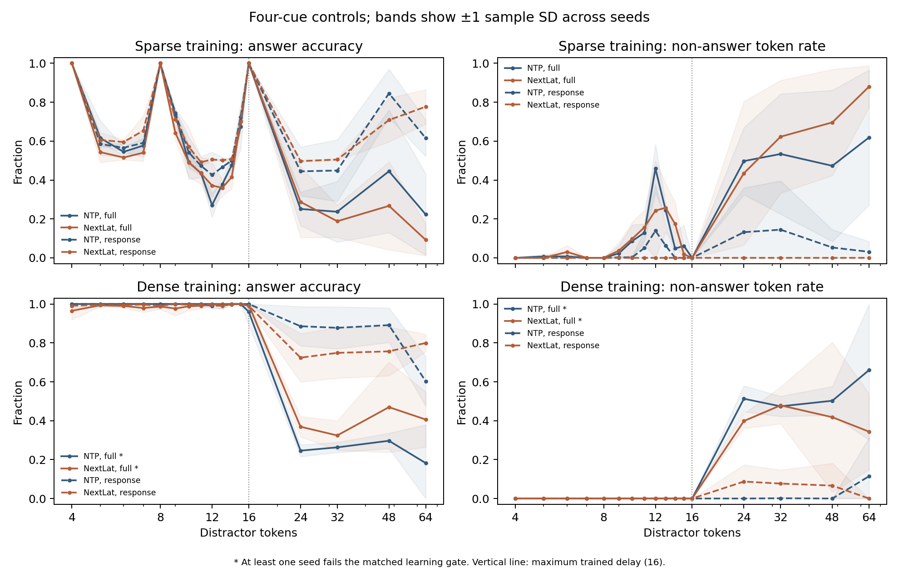

# Four-cue supervision and delay-coverage controls

**Aditi & Sushanth — Science of Deep Learning**

Completed 24/24 runs; fresh seeds [1237, 1238, 1239]; 6000 steps per run. Mean ± sample SD across training seeds; not confidence intervals.

All cells use a four-cue task, 2-layer/128-wide/4-head transformer, batch 32, AdamW learning rate 0.0005, weight decay 0.1 and gradient clip 1. Runs execute on CPU in float32. These are small-model controls, not paper-scale replications.

Sparse training uses delays 4,8,16. Dense training samples every integer 4–16 uniformly. Response-only supervision uses the authors' prompt mask on NTP and KL: only ANSWER/EOS targets are supervised. Context Smooth L1 remains active. Full-sequence supervision matches the previous experiment. NextLat has weight 1, horizon 3 and predictor width 128 throughout. Primary recall is always unrestricted full-vocabulary generation; response masking changes training only. Two-answer recall is a separately labeled diagnostic.

| Condition | Min common-delay recall | Min all-trained-delay recall | Delay 12 recall | Delay 32 recall | Delay 64 recall | Two-answer recall 64 | Non-answer rate 64 | Full learning gate |
|---|---:|---:|---:|---:|---:|---:|---:|---:|
| sparse_full_gpt | 100.0% ± 0.0% | 100.0% ± 0.0% | 27.1% ± 6.3% | 23.7% ± 15.6% | 22.3% ± 20.9% | 53.5% ± 4.4% | 61.9% ± 34.8% | 3/3 |
| sparse_full_nextlat | 100.0% ± 0.0% | 100.0% ± 0.0% | 37.2% ± 11.6% | 18.8% ± 8.3% | 9.2% ± 8.1% | 65.2% ± 13.5% | 88.0% ± 10.7% | 3/3 |
| sparse_response_gpt | 100.0% ± 0.0% | 100.0% ± 0.0% | 42.6% ± 11.7% | 44.9% ± 15.8% | 61.6% ± 9.4% | 64.2% ± 7.4% | 3.1% ± 5.4% | 3/3 |
| sparse_response_nextlat | 100.0% ± 0.0% | 100.0% ± 0.0% | 50.5% ± 0.5% | 50.5% ± 0.5% | 77.7% ± 8.9% | 77.7% ± 8.9% | 0.0% ± 0.0% | 3/3 |
| dense_full_gpt | 96.0% ± 6.9% | 96.0% ± 6.9% | 100.0% ± 0.0% | 26.3% ± 2.6% | 18.2% ± 19.7% | 51.4% ± 3.2% | 66.0% ± 35.9% | 2/3 |
| dense_full_nextlat | 95.6% ± 3.6% | 95.1% ± 3.4% | 99.6% ± 0.7% | 32.4% ± 7.6% | 40.6% ± 14.2% | 61.5% ± 5.1% | 34.4% ± 19.6% | 1/3 |
| dense_response_gpt | 100.0% ± 0.0% | 99.1% ± 1.6% | 99.1% ± 1.6% | 87.8% ± 10.8% | 60.3% ± 12.8% | 66.0% ± 3.3% | 11.5% ± 19.8% | 3/3 |
| dense_response_nextlat | 98.2% ± 1.6% | 98.0% ± 1.7% | 99.6% ± 0.7% | 74.9% ± 13.0% | 79.9% ± 4.5% | 79.9% ± 4.5% | 0.0% ± 0.0% | 3/3 |

## Paired effects at delay 64

Effects below are paired within seed; positive recall is an increase, while negative non-answer rate is a reduction in wrong token types. All seeds are retained even if a learning gate fails. Such cases remain confounded by training performance.

| Contrast | Recall difference (percentage points) | Non-answer rate difference (percentage points) |
|---|---:|---:|
| response_minus_full/sparse/gpt | +39.3 ± 13.3 | -58.8 ± 29.7 |
| response_minus_full/dense/gpt | +42.1 ± 20.4 | -54.6 ± 39.5 |
| dense_minus_sparse/full/gpt | -4.1 ± 5.1 | +4.1 ± 10.3 |
| dense_minus_sparse/response/gpt | -1.3 ± 11.6 | +8.4 ± 23.0 |
| mask_by_distribution_interaction/gpt | +2.8 ± 7.2 | +4.2 ± 13.9 |
| response_minus_full/sparse/nextlat | +68.5 ± 4.9 | -88.0 ± 10.7 |
| response_minus_full/dense/nextlat | +39.3 ± 18.6 | -34.4 ± 19.6 |
| dense_minus_sparse/full/nextlat | +31.4 ± 17.3 | -53.6 ± 27.2 |
| dense_minus_sparse/response/nextlat | +2.2 ± 10.8 | +0.0 ± 0.0 |
| mask_by_distribution_interaction/nextlat | -29.1 ± 23.5 | +53.6 ± 27.2 |
| nextlat_minus_ntp/sparse/full | -13.1 ± 24.6 | +26.1 ± 35.8 |
| nextlat_minus_ntp/sparse/response | +16.1 ± 15.2 | -3.1 ± 5.4 |
| nextlat_minus_ntp/dense/full | +22.4 ± 33.7 | -31.6 ± 55.0 |
| nextlat_minus_ntp/dense/response | +19.7 ± 10.6 | -11.5 ± 19.8 |

## Verification and interpretation limits

The source snapshot and plan hashes match. All training histories are finite and sequential. Models/masks share exact training streams within each schedule; all four cells share the same evaluation and probe-training families per seed. Probe training uses delays 4,8,16 in every cell, avoiding unequal decoder-training budgets. Probe/test families are disjoint. The response/EOS never enters an evaluation forward pass.

The full gate requires both matched models to reach at least 95% recall at every delay trained in that cell. The common gate uses only 4,8,16. Delay 12 is trained in the dense cells and unseen in the sparse cells; 24,32,48,64 are unseen for every cell. Better performance at 12 in dense training is not OOD extrapolation.

All cells have equal optimization steps and examples, but sparse/dense schedules have slightly different expected token counts. Response masking changes both NTP and KL target normalization and their balance against context Smooth L1. It is a token-supervision intervention, not a head-only intervention. Frozen-probe failures do not prove erasure, and long rollouts can accumulate transition error. These controls do not resolve all positional or memory-capacity confounds.

## Uniform budget extension

All 24 cells were continued from 2000 to 6000 steps after several common-delay validation scores remained below 95%. Original checkpoints/results are preserved. We retained model weights, optimizer state, data RNG and training-stream digest. An integration test verified exact equality between continued and uninterrupted training. This is 24 continued training runs, not 48 independent seeds. Initial test results had already been visible, so this extension is exploratory. No best-test checkpoint was selected; intermediate and final results are both retained.

